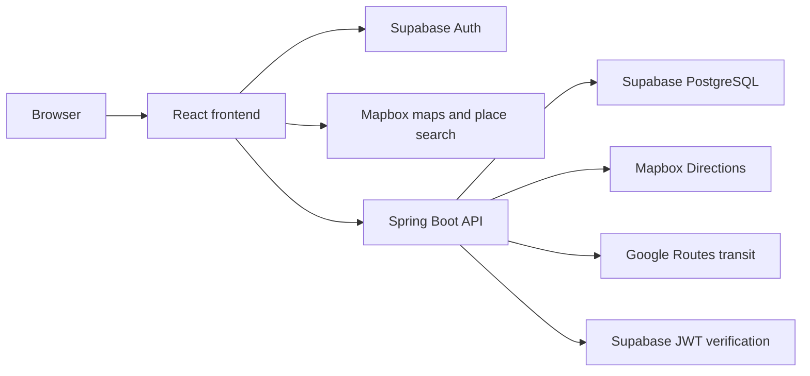

# EcoQuest

Choose your next journey with the planet in mind.

EcoQuest is a sustainable travel application built for HackNC 2026. It helps users compare transportation options, balance environmental impact with everyday priorities, and earn EcoPoints for completed trips. A desktop-inspired interface brings together maps, navigation, progress tracking, and customizable themes.

## Core features

- **Multimodal travel:** Explore walking, cycling, driving, and public transit options.
- **Route comparison:** Compare distance, travel time, estimated cost, environmental scores, and estimated EcoPoints.
- **Personalized recommendations:** Adjust environmental impact, time, cost, and comfort preferences to choose a route that fits your priorities.
- **Navigation:** Preview directions and follow location-aware navigation with maneuver guidance and spoken instructions.
- **Trip tracking:** Start, complete, or cancel trips, and review your trip history.
- **Rewards and progression:** Earn EcoPoints, advance through levels, track achievements, and unlock cosmetic rewards.
- **Profiles and leaderboard:** View personal progress and compare point totals with other users.
- **Customizable appearance:** Choose from Sprouty, Ocean, Sunset, and Fauna themes.

## How it works

### From route planning to rewards

1. Search for an origin and destination on the Explore page.
2. Compare available routes and adjust preference sliders.
3. Sign in or create an account to track a trip and earn points.
4. Select a route, start the trip, and follow its directions.
5. Complete the trip to receive EcoPoints and update your profile, rewards, and leaderboard standing.

Route comparison is available without authentication. Personal trip records, profiles, rewards data, and leaderboard access require a signed-in account.

### Route recommendations

Routes are scored using four weighted preferences: environment, time, cost, and comfort. The default weights are 40%, 30%, 20%, and 10%, respectively. Weights are normalized before scoring, and the frontend updates the recommendation as the sliders change.

Shorter travel times and lower known costs receive higher scores; higher environmental scores are preferred. Comfort uses a mode-specific base score with distance penalties for walking and cycling.

### Emissions and cost estimates

The backend estimates driving emissions at **0.192 kg of CO2 per kilometer** and assigns zero direct travel emissions to walking and cycling. Driving fuel cost uses **12 kilometers per liter** and **$1.45 per liter**; walking and cycling have zero estimated travel cost in this model. Transit itineraries come from Google's routing service, with fare information used when available.

These values are model assumptions used for comparison, rather than measurements of a particular vehicle or journey.

### EcoPoints and progression

The base calculation rewards estimated emissions savings relative to a driving baseline:

```text
EcoPoints = floor(max(0, baseline CO2 kg - estimated CO2 kg) × 20)
```

Walking and cycling use the zero-emissions estimate; transit points are calculated as half the walking points, rounded down. Points shown during planning are estimates. The backend credits points when an active trip is completed, and repeated completion requests do not award points twice. Canceled trips earn no points and are removed from trip history.

Levels advance every **250 EcoPoints** of balance. Achievements track completed-trip and point milestones, while cosmetic rewards unlock at designated levels.

## Technology and architecture

| Layer | Technologies and responsibilities |
| --- | --- |
| Frontend | React, TypeScript, Vite, React Router, Tailwind CSS, and Mapbox GL JS for the interface, maps, and navigation |
| Backend | Java 21, Spring Boot, Spring Security, Spring Data JPA, and Maven for APIs and business logic |
| Authentication | Supabase Auth; bearer JWTs validated by the backend |
| Database | PostgreSQL hosted through Supabase for profiles, trips, and point transactions |
| Routing | Mapbox Directions for walking, cycling, and driving; Google Routes for transit |
| Hosting | Vercel frontend and Railway backend deployment configuration |



The frontend handles route presentation, interactive preference scoring, and navigation state. The backend handles route aggregation, emissions and cost calculations, owned trip records, point awards, rewards, and leaderboard data.

## Project layout

```text
frontend/
  src/
    pages/         Explore, sign-in, profile, rewards, and leaderboard pages
    components/    Shared UI, route cards, navigation panels, and layout
    context/       Authentication and theme providers
    hooks/         Navigation, search, route comparison, and transit hooks
    services/      API clients and trip-session coordination
    lib/           Route scoring, navigation math, and formatting helpers
    types/         Route and navigation types
  public/          Static images and icons
  tests/           Frontend service and trip-session tests
backend/
  src/main/java/hacknc2026/backend/
    client/        Mapbox and Google routing integrations
    config/        Security and CORS configuration
    controller/    REST API endpoints
    dto/           Request and response types
    model/         Persistence entities and trip states
    repository/    Database access
    service/       Routing, emissions, points, profiles, and rewards logic
  src/main/resources/  Application configuration
  src/test/            Backend unit, persistence, security, and API tests
  sql/                 Sample-data and cleanup utilities
pom.xml                Root Maven project containing the backend module
railway.json           Backend deployment configuration
```

## API overview

All application endpoints use the `/api/v1` prefix. Protected requests include a Supabase access token in the `Authorization: Bearer <access-token>` header. The backend derives user identity from the token and restricts trip access to its owner.

| Method | Endpoint | Purpose | Authentication |
| --- | --- | --- | --- |
| POST | `/routes/compare` | Compare walking, cycling, and driving routes | Public |
| POST | `/transit/routes` | Retrieve transit itineraries | Public |
| POST | `/emissions/estimate` | Estimate emissions for a route and mode | Public |
| POST | `/profiles` | Create the current user's profile | Required |
| GET | `/profiles/me` | Retrieve the current user's profile | Required |
| GET | `/profiles/me/points` | Retrieve the point balance | Required |
| POST | `/trips` | Create a planned trip | Required |
| GET | `/trips` | Retrieve paginated trip history | Required |
| GET | `/trips/{id}` | Retrieve an owned trip | Required |
| GET | `/trips/{id}/points` | Retrieve estimated points by mode | Required |
| POST | `/trips/{id}/start` | Start a planned trip | Required |
| POST | `/trips/{id}/complete` | Complete an active trip and award points | Required |
| POST | `/trips/{id}/cancel` | Cancel a planned or active trip | Required |
| GET | `/rewards` | Retrieve levels, achievements, and cosmetics | Required |
| GET | `/rewards/ledger?page=0` | Retrieve paginated point transactions | Required |
| GET | `/leaderboards` | Retrieve ranked user point totals | Required |

Example route comparison request:

```http
POST /api/v1/routes/compare
Content-Type: application/json

{
  "origin": { "latitude": 35.9132, "longitude": -79.0558 },
  "destination": { "latitude": 35.9049, "longitude": -79.0469 },
  "preferences": { "environment": 40, "time": 30, "cost": 20, "comfort": 10 }
}
```

Example trip completion request:

```http
POST /api/v1/trips/<trip-id>/complete
Authorization: Bearer <access-token>
```

Trip progression follows `PLANNED → IN_PROGRESS → COMPLETED`. Cancellation is available from the planned or active state.

## Testing and development

Frontend checks, run from `frontend/`:

```sh
npm test
node --test tests/profileService.test.mjs
npm run lint
npm run build
```

The default frontend test command runs the `.test.cjs` suite; the profile service suite is invoked separately. Frontend tests cover trip-session coordination and profile-service behavior. The build checks TypeScript and produces the Vite production bundle.

Backend checks, run from the repository root:

```sh
./mvnw test
./mvnw package
```

On Windows, use `mvnw.cmd` in place of `./mvnw`. Backend tests cover emissions, points, trip lifecycle, profiles, rewards, persistence, security, transit integration, and API behavior. Test configuration includes an H2 database; production uses PostgreSQL and external routing services.

## Deployment

### Frontend: Vercel

Deploy `frontend/` as the project root, using `npm run build` and the `dist/` output directory. The Vercel configuration rewrites application routes to `index.html` for client-side navigation.

Provide these build-time settings:

- `VITE_API_BASE_URL`: Deployed backend origin.
- `VITE_SUPABASE_URL` and `VITE_SUPABASE_ANON_KEY`: Supabase project URL and public client key.
- `VITE_MAPBOX_KEY`: Browser Mapbox token for maps and place search.
- `VITE_GOOGLE_MAPS_EMBED_KEY`: Google Maps embed key for transit map previews.

### Backend: Railway

The root Maven project builds the backend module. `railway.json` selects Nixpacks and starts `backend/target/backend-0.0.1-SNAPSHOT.jar`. Spring binds to the platform's `PORT` variable, defaulting to 8080.

Provide database credentials through `SUPABASE_DB_URL`, `SUPABASE_DB_USER`, and `SUPABASE_DB_PASSWORD`; routing credentials through `MAPBOX_ACCESS_TOKEN` and `GOOGLE_ROUTES_API_KEY`; and authentication settings through `SUPABASE_JWKS_URL` and `SUPABASE_JWT_ISSUER`. Configure `CORS_ALLOWED_ORIGINS` for the deployed frontend origin.

The backend validates the existing database schema at startup, so the PostgreSQL schema must already match the application entities.

## Team, acknowledgments, and license

EcoQuest was built by the HackNC 2026 project team.

**AI-assisted development:** ChatGPT and Claude assisted throughout the entire development cycle, including ideation, planning, architecture, implementation, debugging, testing, refinement, and documentation.

The project uses Mapbox, Google Maps Platform, Supabase, and the open-source libraries listed in its frontend and backend dependency manifests. Its interface uses Lucide icons and the Geist font.

No project license file is currently included in this repository.
